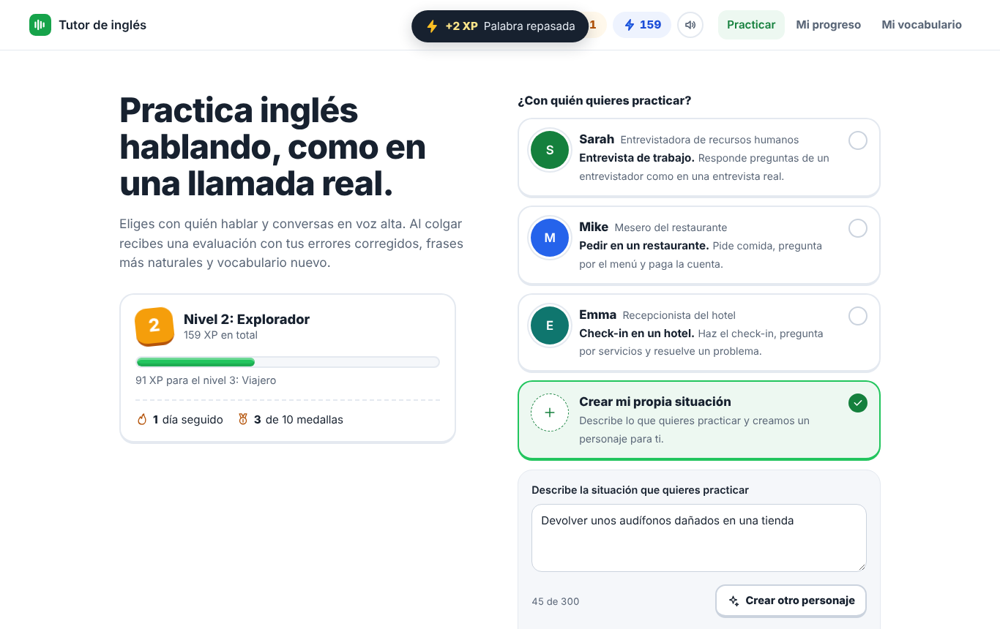
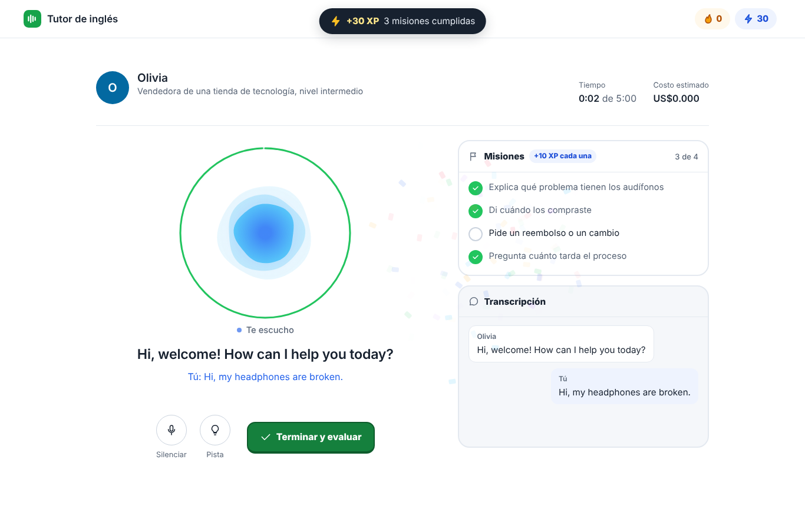
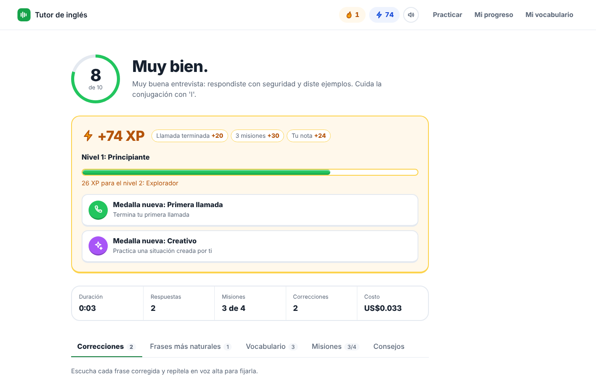
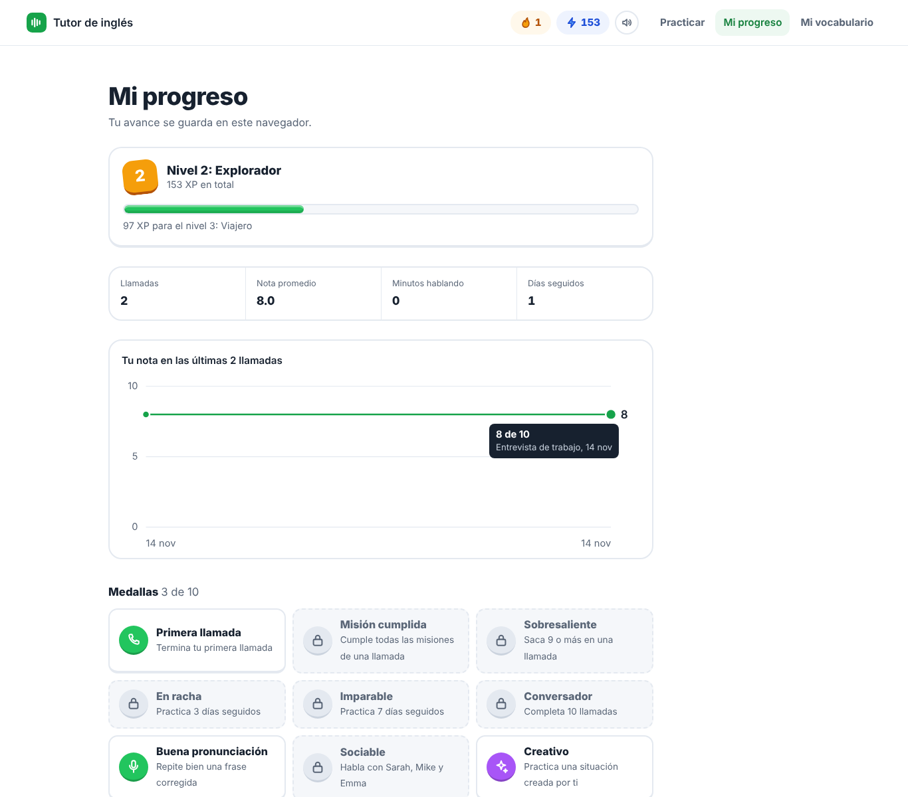
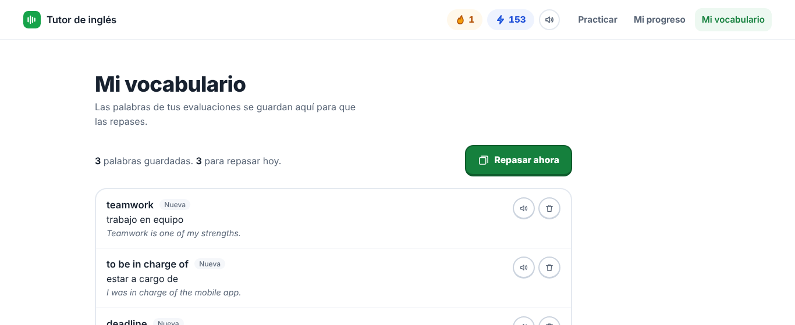

# 🎙️ Tutor de inglés por voz (prototipo)

Practica conversaciones en inglés **hablando en voz alta** con un tutor de IA que hace un papel (entrevistador, mesero, recepcionista). Al terminar recibes una **evaluación en español**: nota, errores con su corrección, frases más naturales, vocabulario útil y consejos.

- 🗣️ Conversación por voz en tiempo real (OpenAI Realtime API por WebRTC), como una llamada con un personaje: Sarah, Mike o Emma, cada uno con su foto y su propia voz (Mike con voz masculina), y la transcripción siempre visible al lado
- 🔮 Orbe animado que reacciona al volumen real de tu voz y la del tutor, con un anillo que marca el tiempo de la sesión
- 💬 Subtítulos grandes de lo que dice el tutor
- 💡 Botón **"Dame una pista"**: traduce al español lo que te dijo el tutor y te sugiere 2 respuestas
- 🎚️ 3 escenarios y 3 niveles (Básico, Intermedio, Avanzado); en Básico el tutor habla más despacio
- ✨ **Crea tu propia situación**: describes lo que quieres practicar (por ejemplo, devolver un producto) y la IA crea un personaje con su papel y sus misiones
- 🚩 **Misiones**: cada llamada tiene 4 objetivos que se marcan solos mientras hablas
- 🔁 **Practica tus correcciones**: escucha la frase correcta y repítela con tu voz; la app te dice qué palabras fallaste
- 📈 **Mi progreso**: historial de llamadas, gráfico de tu nota, días seguidos y tus correcciones recientes para practicarlas otra vez
- 🎮 **Modo juego**: ganas puntos (XP) por cada llamada, misión, frase bien dicha y palabra repasada; subes de nivel (de Principiante a Bilingüe), mantienes tu racha de días y desbloqueas 10 medallas, con confeti y sonidos al cumplir misiones (los sonidos se pueden apagar)
- 🗂️ **Mi vocabulario**: las palabras de cada evaluación se guardan y se repasan con tarjetas (repetición espaciada)
- ✅ Evaluación final: nota animada, estadísticas de la llamada y pestañas con correcciones, frases más naturales, vocabulario (tarjetas que se voltean) y consejos
- 🎨 Diseño claro y divertido (blanco, verde, azul y ámbar para los premios, tipografía Nunito), con botones que se hunden al presionarlos y adaptado a celular
- 💸 Control de costos: duración máxima por sesión, límite de sesiones por día y costo estimado en vivo
- 🔐 Tu API Key nunca llega al navegador: el servidor crea una clave temporal para cada sesión

| Inicio | Conversación | Evaluación |
|---|---|---|
|  |  |  |

| Mi progreso | Mi vocabulario |
|---|---|
|  |  |

---

## 🪟 Cómo ejecutarlo en Windows (VS Code)

Necesitas **Python 3.10 o superior**, una **API Key de OpenAI** con saldo y un navegador moderno (Chrome o Edge).

**1. Clona el proyecto** (en la terminal de VS Code: `Terminal → New Terminal`):

```powershell
cd C:\
git clone https://github.com/kevinbarrera222/tutor-ingles-voz
cd tutor-ingles-voz
```

**2. Crea el entorno virtual e instala las librerías:**

```powershell
python -m venv .venv
.venv\Scripts\Activate.ps1
pip install -r requirements.txt
```

> Si PowerShell no deja activar el entorno, ejecuta una vez:
> `Set-ExecutionPolicy -Scope CurrentUser RemoteSigned` y vuelve a intentarlo.

**3. Configura tu API Key:** copia `.env.example` como `.env` y pon tu clave:

```powershell
copy .env.example .env
```

Abre `.env` en VS Code y cambia `OPENAI_API_KEY=sk-...` por tu clave real. El archivo `.env` está en `.gitignore`: **nunca se sube a GitHub**.

**4. Arranca el servidor:**

```powershell
uvicorn main:app --reload
```

**5. Abre http://localhost:8000**, elige con quién practicar (o crea tu propia situación) y tu nivel, y dale a **Llamar**. La primera vez el navegador te pedirá permiso para usar el micrófono.

> 🎧 Usa audífonos: así el micrófono no capta la voz del tutor.

---

## ⚙️ Configuración (`.env`)

| Variable | Qué hace | Por defecto |
|---|---|---|
| `OPENAI_API_KEY` | Tu clave de OpenAI | — |
| `MAX_MINUTOS_SESION` | Duración máxima de cada conversación | `5` |
| `MAX_SESIONES_POR_DIA` | Sesiones por día para cada visitante | `20` |
| `MAX_AYUDAS_POR_DIA` | Usos por día de cada ayuda (pistas, misiones, personajes, revisión de frases) para cada visitante | `300` |
| `RAPIDEZ_RESPUESTA` | Qué tan rápido responde el tutor cuando dejas de hablar: `high`, `medium` o `low`. Si te interrumpe antes de terminar, usa `medium` | `high` |
| `MODELO_VOZ` | Modelo de voz en tiempo real | `gpt-realtime-2.1-mini` |
| `MODELO_TRANSCRIPCION` | Modelo para transcribir tu voz | `gpt-transcribe` |
| `MODELO_EVALUACION` | Modelo que hace la evaluación final | `gpt-6-luna` |

## 💸 ¿Cuánto cuesta?

Con `gpt-realtime-2.1-mini`, una conversación cuesta del orden de **US$0,02 a 0,05 por minuto**. La app muestra el **costo estimado en vivo**, calculado con los tokens que reporta OpenAI en cada respuesta. Una sesión de 5 minutos sale aproximadamente entre US$0,10 y 0,25. La evaluación final, las pistas, las misiones, la creación de personajes y la revisión de frases suman muy poco. Escuchar las frases correctas usa la voz del navegador, que es gratis.

---

## 🧩 Cómo funciona

```
Navegador ──(1) pide clave temporal──▶ Servidor FastAPI ──▶ OpenAI /v1/realtime/client_secrets
Navegador ◀══(2) voz en tiempo real por WebRTC══▶ OpenAI /v1/realtime/calls
Navegador ──(3) pistas, misiones, personajes y evaluación──▶ Servidor ──▶ gpt-6-luna
Navegador ──(4) grabación al repetir una frase──▶ Servidor ──▶ gpt-transcribe
```

| Ruta | Qué hace |
|---|---|
| `POST /api/sesion` | Crea la clave temporal para la llamada |
| `POST /api/escenario-personalizado` | Crea un personaje y sus misiones a partir de tu descripción |
| `POST /api/misiones` | Revisa qué misiones ya cumpliste |
| `POST /api/pista` | Traduce lo último que dijo el tutor y sugiere respuestas |
| `POST /api/evaluar` | Evaluación final de la llamada |
| `POST /api/verificar-frase` | Transcribe tu grabación y la compara con la frase correcta |

El historial, el vocabulario y los puntos, niveles y medallas se guardan en el navegador (`localStorage`): no hay base de datos.

## 📁 Estructura

```
main.py            # Servidor FastAPI: clave temporal, evaluación y límites
escenarios.py      # Escenarios y niveles (agrega los tuyos aquí)
evaluador.py       # Evaluación, pistas, misiones y personajes (salida estructurada con Pydantic)
practica.py        # Revisión de las frases que repites en voz alta
static/index.html  # Interfaz
static/app.js      # Llamada por WebRTC, misiones, práctica de frases, progreso y vocabulario
static/styles.css  # Estilos (tema claro: colores en las variables del inicio)
docs/              # Capturas para este README
.env.example       # Plantilla de configuración
```

**Cambiar los colores o la tipografía:** todo está en las variables de `:root` al inicio de `static/styles.css`. El color de cada personaje está en `escenarios.py` (campo `color`).

**Agregar un escenario:** copia uno de los bloques de `ESCENARIOS` en `escenarios.py`, cambia el título, la descripción, los `objetivos` (misiones en español) y el `rol` (en inglés), y reinicia el servidor.

**Fotos y voces de los personajes:** cada escenario en `escenarios.py` tiene `genero`, `voz` y `foto`. Las voces femeninas son `marin` y `coral`; las masculinas, `cedar` y `ash`. Los personajes que crea el estudiante reciben una voz y una foto según su género. Las fotos son retratos de [Unsplash](https://unsplash.com) con licencia gratuita: para cambiar una, abre la foto en Unsplash, copia el identificador `photo-...` de su enlace de imagen y pégalo en `foto`. Si una foto no carga, se muestra la inicial del personaje.

## ⚠️ Limitaciones del prototipo

- Sin login ni base de datos: el historial y el vocabulario viven en el navegador (si cambias de navegador o borras sus datos, se pierden) y los límites viven en memoria (se reinician al reiniciar el servidor).
- El corte por tiempo lo hace el navegador.
- Para publicarlo en internet se necesita HTTPS (el micrófono solo funciona en `localhost` o `https`).
